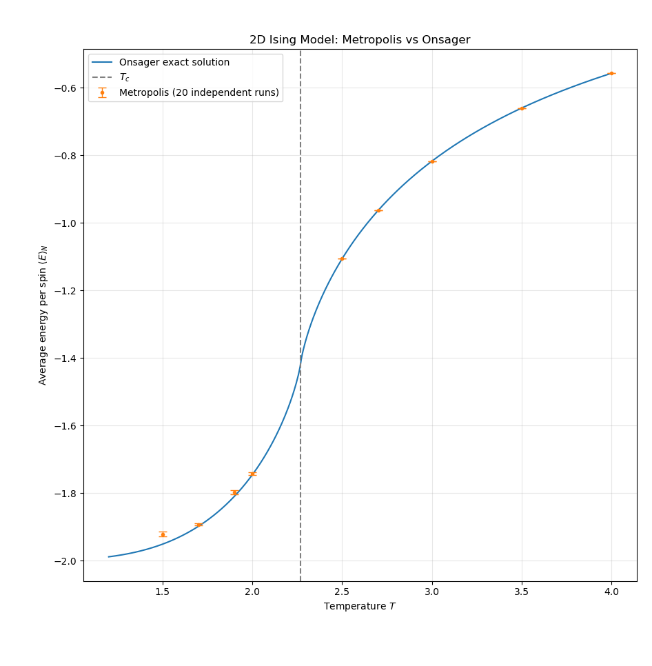
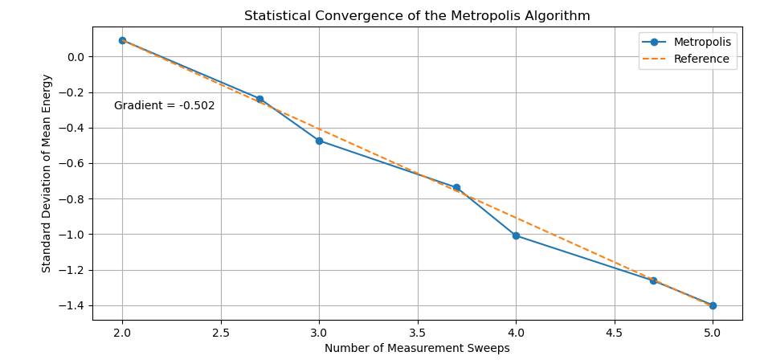

## Match to Onsager's Solution

To measure accuracy to theoretical results I computed the mean energy per spin across different temperatures far from the critical point and averaged over $20$ independently seeded runs. These were compared with Onsager's explicit solution given by
$$
-J \coth(\frac{2J}{T})\left(
    1 + \frac{2}{\pi}(2\tanh^2(\frac{2J}{T}) - 1)\mathcal{K}(k^2) 
\right)
$$
where $\mathcal{K}(k)$ is given by the complete elliptic integral of the first kind, given by
$$
\mathcal{K}(k) = \int_0^{\frac{\pi}{2}} \frac{\mathrm{d}x}{\sqrt{1 - k^2\sin^2(x)}}
$$ 
with the parameter $k$ defined as
$$k = 2\frac{\sinh(\frac{2J}{T})}{\cosh(\frac{2J}{T})^2}$$.

The results of the simulations are given in the figure below

As we can see, the calculated average energies per spin greatly agree with the exact solutuion with very small error bars. The only outlier is the lowest temperature run of $T = 1.5$. I am not yet sure why this is the case.

## Convergence Across Independent Runs

To investigate statistical convergence, $20$ independently seeded Metropolis simulations were performed for each measurement length, ranging from $100$ to $100,000$ sweeps. Each simulation used a $4\times 4$ lattice at $T = 2.0$, following $10,000$ equilibration sweeps.

The energies were compared against an exactly computed mean energy (only possible for small lattice sizes).

The standard deviation of the estimated mean energies decreased consistently as the number of measurement sweeps increased. At $100$ sweeps, the standard deviation was approximately $1.238$ compared with $0.0399$ at $100,000$ sweeps.

This representts a reduction by a factor of around $31$, in close agreement with the theoretical expectation of $\sqrt{1000} \approx 31.6$ for a $1,000$ fold increase in the number of measurements.

Moreover, for sufficiently long simulations, the standard deviation of the Monte Carlo estimator is expected to scale approximately as

$$\sigma_{\overline{E}} \propto N^{\frac{1}{2}}$$

where $N$ is the number of measurement sweeps.

To investigate this relationship, the measured standard devations were plotted against the number of measurement sweeps on logarithmic axes, alongisde a reference curve for the $-\frac{1}{2}$ power scaling law.

As we can see, the measured results closely follow the expected scaling, with a gradient of $-0.502$ - incredibly close to the theoretical relationship.

Although the absolute error between the Monte Carlo mean and the exact mean fluctaed between measurement lengts, all estimates remained within less than one standard errors of the exact result.

These results support the conclusion that the Metroplolis algorithm correctly reproduces the equilibrium average energy of the $4\times 4$ Ising model, within statistical precision of simulations.
